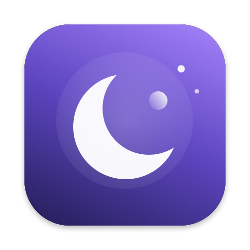

<p align="center">
  
</p>

<h1 align="center">Hush Browser 🌙</h1>

<p align="center">
  <b>The calm, fast, private browser for your Mac.</b><br>
  Ads and trackers get hushed. You get the web back. ✨
</p>

<p align="center">
  <a href="https://github.com/danxharvard/hushbrowser/releases/latest"><b>⬇️ Download Hush for Mac</b></a>
  &nbsp;·&nbsp; 🍎 macOS 13 Ventura or later &nbsp;·&nbsp; 💻 Apple Silicon &amp; Intel &nbsp;·&nbsp; 🆓 Free
</p>

---

## 👋 Meet Hush

Most browsers are huge, noisy and busy watching you. Hush is the opposite.

It's a **truly native Mac app** 🍏 built on **WebKit**, the same engine that powers Safari. So it's
light on your battery, quick on your fingertips and feels right at home on your Mac. Then we
added the good stuff: a **built-in ad and tracker blocker** 🛡️, a **gorgeous design** 🎨 and lots of
small touches that make browsing a pleasure again.

No bloat. No tracking. No nonsense. Just *hush*. 🤫

---

## 💜 What makes Hush, Hush

### ⚡️ Blazing fast
- 🧠 **WebKit inside**: Apple's own engine, tuned for the Mac and for Apple Silicon.
- 🚫 **Blocking happens before pages load.** Ads and trackers are stopped before they download,
  so pages show up sooner and use less data.
- 😴 **Tab Sleep**: tabs you're not using take a nap and give back memory and battery. They wake
  up exactly where you left them.

### 🐜 Small but mighty
- 📦 **About a 5 MB download.** Chrome-based browsers are often well over a hundred.
- 🔋 No hidden background helpers and no bundled copy of Chrome. Just one tidy, native app.
- 🧩 And it still runs **Chrome and Safari extensions** (macOS 15.4 or later).

### 🛡️ Hush Guard: ad & tracker blocker
- 🙅 **Blocks ads and trackers** out of the box, and shows a live count of what it stopped.
- 🍪 **Hides cookie banners** so you don't have to click "Reject all" a hundred times a day.
- 🧹 **Collapses empty ad spaces**, so pages look clean instead of full of holes.
- 🔌 **Turn it off for one site** with a single click, whenever you need to.
- 📋 **Bring your own filter lists**: EasyList, uBlock Origin and Adblock Plus lists, hosts files and
  Safari content blockers.
- 🪄 **Element Zapper**: click anything annoying on a page and it's gone for good.

### 🔒 Private by design
- 🕵️ **Third-party cookies blocked** and **Global Privacy Control** sent to every site.
- 🔗 **Clean Links**: removes the tracking tags (`utm_source`, `fbclid`, `gclid`…) that follow you
  from site to site.
- 🔐 **HTTPS upgrade**: secure connections whenever a site supports them.
- 🎣 **Fake-site warnings**: Hush spots look-alike addresses like `paypa1.com` and warns you
  before you type anything.
- 📍 **Hush never uses your Mac's location.** Websites can ask, and Hush checks with you first.
- 🔑 **Passwords & AutoFill** stored in your Mac's Keychain, filled only after Touch ID.
- 🏠 Your history and bookmarks stay **on your Mac**. Always.

### 🎨 Gorgeous to look at
- 🌌 **Beautiful start pages** (Twilight, Aurora or Plain) in light and dark mode.
- 🌙 A moon logo that **eclipses trackers** in a little animation.
- 🪟 Frosted glass, soft shadows and smooth animations, with **Reduce Motion** if you prefer calm.
- 🎛️ A clean, **Safari-style Settings window** with no clutter.

### 😌 A pleasure to use
- 🔎 **Smart address bar** with live suggestions from Google, DuckDuckGo, Bing, Brave Search or Ecosia.
- ⭐️ **Favourites, suggestions and a privacy report** right on your start page.
- 🌤️ **Personalise Start Page**: type your town or postcode and see your local weather.
- ↩️ **Recently closed tabs** one click away, and your session restored when you come back.
- 🚚 **Move in easily**: bring your history over from Safari, Chrome, Brave, Edge, Arc, Vivaldi
  or Firefox, so your favourite sites are suggested from day one.
- 🔄 **Updates itself** quietly, and shows you what's new after each update. 🎁

---

## 🚀 Get started in 30 seconds

1. ⬇️ Download **HushBrowser-x.y.z.dmg** from the [latest release](https://github.com/danxharvard/hushbrowser/releases/latest).
2. 📂 Open it and drag **Hush Browser** onto **Applications**.
3. 🔓 The first time you open it, macOS says it can't verify Hush, because Hush isn't signed with a
   paid Apple Developer ID. Click **Done**, then go to **System Settings › Privacy & Security**,
   scroll to **Security** and click **Open Anyway** next to Hush Browser. You only do this once.
4. 🎉 Done. Enjoy the quiet.

All settings live in **Hush Browser › Settings…** (⌘,).

---

## 🤝 Our promises

| | |
| --- | --- |
| 🙈 | **No tracking.** Hush doesn't collect analytics about you, at all. |
| 🏠 | **Your data stays on your Mac.** Bookmarks, history and passwords never go to our servers, because we don't have any. |
| 🔍 | **Out in the open.** Every line of Hush is right here for anyone to read. |
| 🪶 | **Light forever.** New features have to earn their place. |

<details>
<summary>🔬 <b>The privacy fine print</b></summary>

- Live search suggestions send what you type in the address bar to your chosen search engine,
  like every browser does. You can turn them off in Settings › General.
- Personalise Start Page sends the town or postcode you type to Apple to find the place, and
  only its rough position (to about 1 km) to Open-Meteo for the weather. It's off until you
  set it up.
- The blocked-ads counter uses WebKit's own reporting of blocked requests, the same one
  Safari uses.
- Site icons come from each site directly, not through a third-party icon service.
- Bookmarks and history are stored only in `~/Library/Application Support/Hush Browser/`.
- Passwords and cards are stored in the macOS Keychain and filled only after Touch ID or your
  password.
- Updates come only from this repository's releases. Hush checks each download's checksum
  and signature before installing it.

</details>

---

## 🛠️ For developers

<details>
<summary>🏗️ <b>Build from source</b></summary>

All you need is Apple's Command Line Tools (`xcode-select --install`). Xcode is optional.

```bash
./scripts/build-app.sh
```

This makes `build/Hush Browser.app`, `build/HushBrowser-<version>.dmg` (the installer) and
`build/HushBrowser-<version>.zip` (what installed copies download to update themselves).

</details>

<details>
<summary>📦 <b>Releasing an update</b></summary>

1. Go through [RELEASING.md](RELEASING.md) (security, bug and performance review). Then put the
   new version number in `VERSION`, note the changes in `CHANGELOG.md` and commit.
2. Tag and push:

   ```bash
   git tag v1.2.3 && git push origin main v1.2.3
   ```

GitHub Actions (`.github/workflows/release.yml`) builds the app and publishes a release with the
DMG and the update zip. The release notes come from `CHANGELOG.md`. Installed copies check every
few hours and install the update the next time they quit, or straight away from
Settings › Software Update.

</details>

<details>
<summary>🗺️ <b>Project layout</b></summary>

| File | What it does |
| --- | --- |
| `Sources/HushApp.swift` | App entry point, menus and keyboard shortcuts |
| `Sources/BrowserWindow.swift` | Window layout, toolbar, Hush Guard panel, page area |
| `Sources/BrowserModel.swift` | A window's tabs |
| `Sources/BrowserTab.swift` | One tab: the WebKit view, navigation, pop-ups, Tab Sleep |
| `Sources/AddressBar.swift` | Address field and turning typed text into a URL or search |
| `Sources/Suggestions.swift` | Live search and bookmark suggestions |
| `Sources/TabStrip.swift` | The tab strip |
| `Sources/Bookmarks.swift` | Bookmarks, bookmarks bar and site icons |
| `Sources/StartPage.swift`, `Sources/StartData.swift` | The start page and recently closed tabs |
| `Sources/PersonaliseStartPage.swift` | Personalise Start Page: town and postcode search |
| `Sources/SettingsStore.swift` | Every setting's key and default |
| `Sources/SettingsView.swift` | The Settings window |
| `Sources/ContentBlocker.swift` | Hush Guard: blocking, per-site on/off, blocked counter |
| `Sources/FilterConverter.swift` | Turns imported filter lists into WebKit rules |
| `Sources/ElementZapper.swift` | Click-to-hide for page elements |
| `Sources/CleanLinks.swift` | Removes tracking tags from links |
| `Sources/Lookalike.swift` | Fake look-alike site warnings |
| `Sources/Location.swift` | Website permissions and start page weather |
| `Sources/Autofill.swift` | Passwords, cards and contact AutoFill (Keychain + Touch ID) |
| `Sources/History.swift` | History, suggestions and importing from other browsers |
| `Sources/Downloads.swift` | Downloads and the downloads list |
| `Sources/Extensions.swift` | Chrome and Safari extensions and their toolbar buttons |
| `Sources/Updater.swift` | Checks for, downloads and installs updates |
| `Sources/ReleaseNotes.swift` | What's New and the release notes in Settings |
| `Sources/Welcome.swift` | Welcome screen and default-browser prompt |
| `Sources/HushLogo.swift` | The Hush moon logo, drawn in code |
| `scripts/build-app.sh` | Builds the app, update zip and DMG |
| `scripts/make-dmg-background.swift`, `scripts/dmg-settings.py` | The styled installer window |
| `scripts/make-icon.swift` | Draws the app icon |

</details>

---

<p align="center">
  Made with 💜 for the Mac. Now go enjoy a quieter web. 🌙✨
</p>
